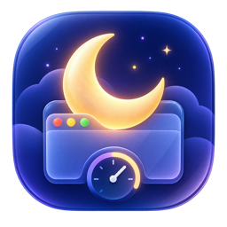

# Subdue

<p align="center">
  
</p>

<p align="center">
  Schedule an application to close, or mute system audio, on macOS, Windows,
  and Haiku.
</p>

<p align="center">
  
  
  
  
  
</p>

Subdue is one utility with three independent, native implementations. It does
not use a cross-platform UI framework: each edition follows its operating
system's application model, visual conventions, process APIs, and audio APIs.

- **Subdue** schedules a running application to close.
- **Smother** schedules the system's default audio output to mute.

Schedules can run after a number of minutes, at a specific local time, or at
the top of the next hour. Force-close is enabled by default when an application
does not respond to a graceful close request within ten seconds.

## Native editions

| Platform | Native technology | Background status | Source and instructions |
| --- | --- | --- | --- |
| macOS | Swift, SwiftUI, AppKit and Core Audio | Menu bar countdown | [macOS source](Subdue/) · [build instructions](#macos) |
| Windows | C++20, Win32 and Core Audio | Notification-area countdown | [Windows source and guide](windows/) |
| Haiku | C++17, Application/Interface/Media Kits | Deskbar countdown | [Haiku source and guide](haiku/) |

The platform versions may differ while the newer ports settle. The macOS and
Windows editions are currently version 0.11; the Haiku edition is version
0.2.1.

## Features

| Capability | macOS | Windows | Haiku |
| --- | :---: | :---: | :---: |
| Native graphical interface | ✓ | ✓ | ✓ |
| Native command-line interface | ✓ | ✓ | ✓ |
| Close a running application | ✓ | ✓ | ✓ |
| Mute default/system audio | ✓ | ✓ | ✓ |
| After N minutes | ✓ | ✓ | ✓ |
| At a local `HH:mm` time | ✓ | ✓ | ✓ |
| Top of the next hour | ✓ | ✓ | ✓ |
| Graceful close, then optional force-close | ✓ | ✓ | ✓ |
| Live background countdown | Menu bar | Notification area | Deskbar |

## Quick command-line examples

macOS:

```sh
open -a Subdue --args --app Safari --after 30
open -a Subdue --args --mute --top-of-hour
```

Windows:

```bat
Subdue.exe --app notepad --after 30
Subdue.exe --mute --at 23:30
```

Haiku:

```sh
./Subdue --app StyledEdit --after 30
./Subdue --mute --top-of-hour
```

See the platform guides for every option and platform-specific behavior.

## Build

### macOS

Requirements: macOS 14 or later and Xcode with the macOS SDK.

```sh
xcodebuild \
  -project Subdue.xcodeproj \
  -scheme Subdue \
  -configuration Debug \
  CODE_SIGNING_ALLOWED=NO \
  build
```

Create the Universal macOS installer package:

```sh
scripts/build-package.sh
```

### Windows

Requirements: Windows 10 or 11 and Visual Studio 2022 with **Desktop
development with C++**.

```bat
cd windows
build-windows.bat
```

See the [Windows guide](windows/README.md) for Visual Studio and CMake builds.

### Haiku

Requirements: Haiku with its standard development tools.

```sh
cd haiku
make
make test
```

See the [Haiku guide](haiku/README.md) for installation, Deskbar controls, and
the command-line interface.

## Repository layout

```text
Subdue/             macOS Swift source and assets
Subdue.xcodeproj/   macOS Xcode project
scripts/            macOS packaging scripts
windows/            native Windows C++ implementation
haiku/              native Haiku C++ implementation
.github/            GitHub issue, pull-request, and build configuration
```

Release binaries should be attached to a tagged GitHub Release rather than
committed to the repository. A release can carry the macOS installer, Windows
ZIP, and Haiku HPKG for their corresponding platform versions.

## Project status

- macOS and Windows build/package scripts are present.
- The Haiku port has working Subdue and Smother actions, Deskbar integration,
  schedule recovery, notifications, tests, and selected icon artwork.
- The remaining Haiku release work is HVIF embedding and a HaikuPorts recipe.

## Contributing

Bug reports and platform-specific testing are welcome. Read
[CONTRIBUTING.md](CONTRIBUTING.md) before submitting changes.

## Author and copyright

Subdue was created by **Sikosis**. Unless a file explicitly states otherwise,
all original source code in this repository is by Sikosis. See
[AUTHORS.md](AUTHORS.md).

## License

A public software license has not yet been selected. Until a `LICENSE` file is
added, the source remains copyright Sikosis with no general permission to
redistribute or modify it. A recognized open-source license is required before
the HaikuPorts submission can be accepted.
